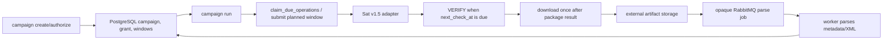

# SAT v1.5 code/documentation audit — 2026-07-19

## Purpose and boundary

This audit compares the productive SAT v1.5 campaign documentation with the
current code paths. It is an offline repository audit: it did **not** contact
SAT, load credentials, create a request, verify a request, or download a
package. No fiscal artifact or raw SAT response belongs in this document.

The canonical operational document is
[SAT campaign runbook](../runbooks/sat-campaign.md). This file records what a
human can verify in code, what has been observed privately, and what is still
unproven.

## Evidence labels

| Label | Meaning |
|---|---|
| `confirmed` | Directly supported by the current code and automated tests. |
| `observed_once` | Seen in private runtime state or one live run; not a stable SAT behavior claim. |
| `inconclusive` | No real SAT artifact or terminal response is available to decide the hypothesis. |
| `gap` | Documentation, output, or implementation needs correction before the next live contact. |

## Human-traceable flow

## Code-to-contract map

| Contract | Code path | Durable or safety rule |
|---|---|---|
| Public SAT surface | `adapters/cli/app.py`, `adapters/cli/sat.py`, `adapters/cli/sat_campaign*.py` | Public help exposes only `sat campaign create`, `authorize`, `run`, and `status`. |
| Campaign/grant | `sat_campaign_db_cli.py`, `recovery_db.py`, `V3__sat_campaign_state.sql`, `V4__sat_claim_grants.sql` | PostgreSQL is the source of truth; grants bind profile, phase, commit, and budget. |
| Submission | `sat_db_campaign_runner.py::_submit_windows` | Planned windows are submitted only after a durable claim and only while two open operations are available. |
| Due VERIFY | `sat_campaign_repository.py::claim_due_operations` | `next_check_at` and the service deadline are checked in PostgreSQL with row locking. |
| Calendar | `sat_db_campaign_runner.py::next_local_check` | 5m, 15m, 30m, 1h, 2h, 4h, then 8h; later SAT time wins. |
| Result mapping | `sat_db_campaign_runner.py::_classify_result` / `_classify_error` | `5000`, `5003`, `5004`, `5005`, expiry, timeout, and package outcomes are categorized. |
| Download | `sat_db_campaign_runner.py::_download_packages` | A download claim is persisted before the external effect; uncertain downloads are not retried automatically. |
| Package safety | `sat_campaign_artifacts.py`, `sat_campaign_download_effects.py` | ZIP/TXT/XML are external; limits, traversal, duplicates, encoding, and XML safety are validated. |
| Handoff | `ledger_outbox_publisher.py`, `ledger_job_consumer.py`, `ledger_job_dispatch_store.py`, `accounting_ledger_worker.py` | V6/V7 persist outbox/inbox/claims; RabbitMQ carries opaque references; the worker hydrates from PostgreSQL and completes before ACK. |
| Monitor/worker operations | `sat_monitor_service.py`, `worker.py`, `cache.py`, `docker-compose.yml` | Five-minute monitor wake uses an owner-fenced Redis lease when configured, PostgreSQL advisory fallback otherwise; workers publish expiring redacted lifecycle events and heartbeat; SAT contact stays disabled unless explicitly enabled. |

## Findings and disposition

### `SAT-DOC-001` — runner output contract (confirmed after correction)

The live runner result was consumed by the CLI as `status` and
`next_check_at`, while the report model previously exposed only
`next_due_at`. That produced an unhelpful `status=None`/`next_check_at=None`
shape even when the runner had processed work.

The report boundary now emits both names, plus a deterministic status:
`no_due_operations`, `processed`, `busy`, or `error`. A regression test covers
the CLI-facing shape. The internal `next_due_at` name remains for Python
callers.

### `SAT-DOC-002` — planned submission wording (confirmed after correction)

The runner does more than verify an existing request: an authorized campaign
may claim and submit a `planned` window. Existing submitted/waiting/package/
uncertain work is not replaced. The canonical runbook now states both rules
and documents the two-operation ceiling.

### `SAT-DOC-003` — retired command references (documentation corrected)

The public registration boundary exposes only the campaign family, but older
source modules and historical documents still contain names such as smoke,
probe, diagnostic, backfill, and legacy scheduler. They are not public SAT
commands. The README index now points to the productive runbook; the former
manual runbook is a compatibility pointer; the VERIFY transport note is
explicitly historical and non-executable.

The old modules remain an **open cleanup item** until a separate import-graph
review can remove them without breaking offline tests. Their presence is not
evidence that those paths are supported.

### `SAT-DOC-004` — private live state (observed_once)

The latest private runtime check before this audit retained four Metadata
requests and eight pending VERIFY attempts. No package had been registered and
no TXT import had completed. This confirms persistence and resumption only; it
does **not** prove SAT package readiness, a valid ZIP, TXT structure, or worker
processing.

### `SAT-DOC-005` — real package path (inconclusive)

The code path for ZIP → external storage → opaque queue job → worker →
PostgreSQL import is implemented and covered with synthetic/fake tests. No
real ZIP/TXT/XML is present in Git or public logs, so the first real package and
worker handoff remain the next integration milestone.

### `SAT-DOC-006` — monitor activation (confirmed)

Compose starts `sat-monitor`, but `SAT_MONITOR_ENABLED=0` and
`CFDI_VAULT_LIVE_WORKER_ENABLED=0` are the defaults. When enabled, the service
uses an owner-fenced Redis lease when configured and emits only a sanitized
heartbeat; it can wake and report a no-op without contacting SAT. Enabling the live worker still requires
the documented human gate, clean-tree/scanner evidence, canonical endpoints,
profile, campaign, and grant.

## What is tested versus what is SAT evidence

The local full suite completed with **2356 passed, 87 skipped** after the
worker lifecycle and durable-handoff changes. Targeted Ruff and format checks
on the changed worker/cache/ledger/CLI-test files passed. The skips are
environment/integration-gated and do not become SAT evidence. The
sensitive-fixture scanner, SAT-context scanner, and `git diff --check` passed.
The Docker CLI is not installed in this environment, so `docker compose
config` and PostgreSQL/RabbitMQ container checks remain unverified rather than
being treated as passed.
The repository-wide Ruff command still reports the pre-existing legacy CLI
star-import baseline; this patch does not widen that unrelated cleanup. Only
the changed worker/cache/ledger/CLI-test files are covered by the passing
targeted Ruff gates.

| Area | Current evidence | Classification |
|---|---|---|
| CLI command family and redaction | Help and CLI contract tests | `confirmed` |
| PostgreSQL claims, idempotency, two-operation ceiling | Repository integration tests | `confirmed` |
| VERIFY schedule and error categories | Runner tests with fake adapter | `confirmed` |
| ZIP/TXT/XML limits and external storage | Synthetic artifact/worker tests | `confirmed` for code, not SAT behavior |
| Compose dependencies and disabled monitor defaults | Source inspection; Docker CLI unavailable for config/runtime check | `confirmed` for source, container gate unverified |
| SAT authentication, submission, VERIFY, package response | No new contact in this audit | `inconclusive` |
| Real ZIP/TXT and worker inventory | No artifact available | `inconclusive` |

Synthetic tests validate implementation contracts only. They must never be
reported as SAT integration evidence.

## Required operator record for the next live run

Keep the private append-only record with the following sanitized fields only:

- campaign/window direction and date range;
- grant phase and commit reference (no secret material);
- one row per claim: scheduled time, contact time, attempt number, category,
  result, next review, and service-window state;
- package count, ZIP/TXT/XML validation booleans, and worker job counts;
- final category: `pending`, `package`, `no_data`, `expired`,
  `service_window_exceeded`, `uncertain`, or categorized error.

Never copy RFCs, UUIDs, full SAT identifiers, SOAP, tokens, rows, ZIP/XML/TXT,
storage paths, or credential references into Git, issues, or chat.

## Open actions

1. Run the remaining container gates on a host with Docker Compose and clean PostgreSQL/RabbitMQ/Redis services.
2. Keep the existing requests; do not create replacements while their 48-hour
   service windows are active.
3. Execute the next real `campaign run` only under the already approved human
   gate and only when PostgreSQL says the operation is due.
4. When the first real package arrives, record ZIP/TXT validation and worker
   aggregates here without copying the artifact.
5. After the first TXT is proven, issue a separate `cfdi-proof` grant before
   any CFDI/XML request.
6. Schedule a separate cleanup issue for the retired internal modules and
   historical planning references; do not remove them opportunistically during
   a live run.

## Audit conclusion

The documented productive path now matches the implemented PostgreSQL runner,
claims, artifact store, queues, worker, and Compose monitor at the public
boundary. The principal remaining uncertainty is empirical: no real SAT ZIP/TXT
has yet been returned and processed. The next success criterion is therefore a
single real Metadata package followed by an idempotent worker import—not a
larger synthetic test suite or a new SAT request.
