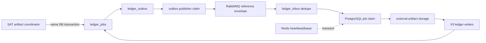

# Durable ledger jobs V6/V7 architecture

Status: implemented in the repository; PostgreSQL/RabbitMQ container
verification remains an environment gate. This document describes the
offline implementation boundary. It is not SAT integration evidence.

## Purpose

V6 makes parser work durable before it crosses RabbitMQ. V7 adds an opaque
publisher claim and fencing token so a restarted publisher cannot complete an
outbox event using a lease it no longer owns.



## Durable ownership

| Concern | Durable owner | Allowed broker/cache content |
|---|---|---|
| Job identity and status | `ledger_jobs` | opaque job/reference fields only |
| Worker attempts and leases | `ledger_job_claims` | never stored in Redis as truth |
| Publish handoff | `ledger_outbox` | event/job references, schema version |
| Consumer deduplication | `ledger_inbox` | event and consumer references |
| Raw ZIP/TXT/XML | configured artifact store | never PostgreSQL message payloads |
| Heartbeat and monitor lease | Redis, with PostgreSQL fallback for monitor fencing | expiring worker reference and timestamp only |

The database is the source of truth. RabbitMQ is at-least-once transport, not
an exactly-once store. Redis is transient observability and coordination; a
Redis outage must not turn successful durable work into a retry or dead letter.

## State and claim rules

Jobs use these states:

```text
queued -> claimed -> running -> succeeded
                         |-> duplicate
                         |-> failed
                         |-> uncertain
                         |-> dead_letter
```

- `claim_job` and `claim_parse_job` use short transactions and
  `FOR UPDATE SKIP LOCKED`.
- The claim is committed before parser or storage I/O.
- A claim lease expiry records `lease_expired`, then returns a non-terminal job
  to `queued` with a new attempt. `uncertain` and terminal jobs are never
  requeued automatically.
- Terminal job rows are immutable. Claim history is append-only: only the
  completion fields of an open claim may be filled once.
- `idempotency_key` is unique per tenant/job type. A duplicate never invokes
  the parser.

## Outbox and inbox ordering

1. Create the job, artifact reference, and outbox event in one PostgreSQL
   transaction.
2. Commit before publishing to RabbitMQ.
3. Claim the outbox event with V7 `claim_id` and `claimed_by`.
4. Publish a reference-only envelope and require a publisher confirm.
5. Mark `published` only while the same fencing claim is valid.
6. On consumer delivery, register `(event_id, consumer_name)` in
   `ledger_inbox` before parsing.
7. Claim the job, commit, read external storage, run V5 writers, persist
   aggregates, then mark the inbox processed before acknowledging RabbitMQ.

Outbox publication uses a capped retry delay: failed or unconfirmed claims
become due after 5 seconds, then 30 seconds, then every 5 minutes. They remain
retryable because a broker outage can occur after acceptance but before the
publisher records confirmation; the durable inbox deduplicates any later
duplicate. An `invalid_reference` envelope is deterministic and is fenced as
terminal `uncertain` before any broker I/O, so malformed references are never
retried automatically.

If the publisher dies after RabbitMQ accepts a message but before PostgreSQL
records `published`, the event may be delivered again. The inbox constraint
and job idempotency handle that redelivery; transport is deliberately not
claimed to be exactly once.

The installed Pika adapter returns `None` after a successful confirmed publish;
the queue boundary therefore treats only an explicit `False` or exception as a
negative confirmation. This behavior was verified against RabbitMQ in a
synthetic Compose run, with no SAT contact.

## Public data boundary

The wire envelope contains only opaque references, queue/schema metadata,
correlation, and idempotency fields. It never contains RFCs, CFDI UUIDs,
criteria, rows, totals, SOAP, credentials, ZIP bytes, XML, or TXT content.
Status/report objects expose only counts and fixed reason codes.

## Compose operation

`postgres -> flyway -> worker` is the startup dependency. RabbitMQ and Redis
must be healthy before the worker starts. `ledger-publisher` is a separate
PostgreSQL/RabbitMQ service with an explicit disabled-by-default gate;
`LEDGER_OUTBOX_ENABLED=1` is required for the synthetic handoff run. The
publisher has no SAT side effect. `sat-monitor` remains a separate service and
is disabled by default; this V6/V7 implementation does not authorize or
contact SAT. The worker emits transient
`worker_started`, `worker_heartbeat`, `worker_idle`, and `worker_stopped`
events with a finite TTL.

## Rollback and evidence

Rollback is manual and reverse-order only: stop workers and publishers, drain
queues, audit leases and outbox/inbox state, verify a database backup, then
remove V7 constraints before V6 objects if rollback is explicitly approved.
The migration comments contain the guarded SQL outline; no automatic `DROP`
is executed.

Local evidence currently available:

- full offline suite and targeted worker/outbox tests;
- sensitive-fixture and SAT-context scanners;
- focused Ruff/format checks and `git diff --check`;
- fresh code review of lifecycle, fencing, redelivery, and redaction paths;
- `docker compose config` plus a disposable Compose run with PostgreSQL 16,
  Flyway V1-V7, RabbitMQ, and Redis;
- synthetic outbox publication through RabbitMQ, worker consumption, and
  duplicate delivery deduplication in `ledger_inbox`.

The repository-wide Ruff command still reports the pre-existing legacy lint
baseline outside this unit; all touched files pass focused Ruff and format
checks. No SAT endpoint or credential was used. The separate human-gated SAT
phase remains blocked until the global lint baseline is handled explicitly.
