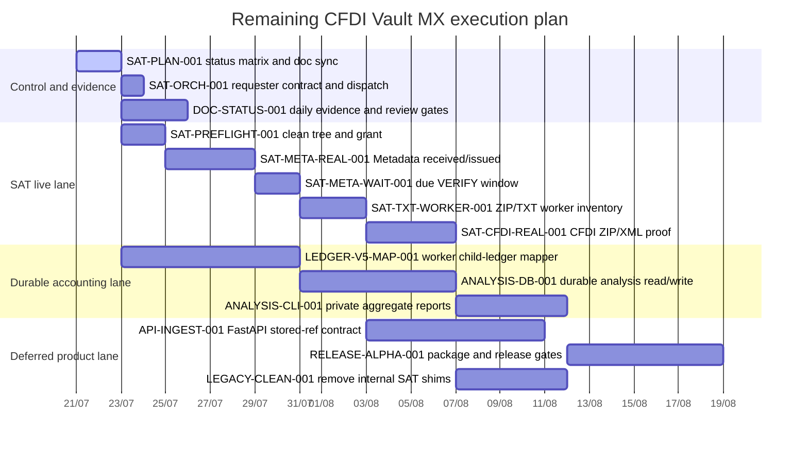

# SAT program master plan — live proof to financial analysis

This is the dated execution plan for the remaining product milestones. It is
not a promise that SAT will answer within a planned day; the SAT lane keeps its
request and observes the persisted `next_check_at`/48-hour window. Dates are
planning targets, while evidence and gates determine actual completion.

## Outcome

Close one complete, auditable path:

```text
campaign/grant → Metadata request → due VERIFY → ZIP/TXT
→ external storage → RabbitMQ job → worker inventory
→ CFDI grant → CFDI ZIP/XML → V5 ledger mapping → financial reports
```

## Dated Gantt



## Milestones and gates

| Milestone | Target | Exit evidence | Stop condition |
|---|---|---|---|
| M0 — plan synchronized | 2026-07-22 | Status matrix, owners, dependencies, and daily log committed. | Any document claims a feature is complete without code/test evidence. |
| M1 — live preflight | 2026-07-24 | Clean tree, current commit, canonical endpoints, external storage, healthy Compose, valid profile, exact grant. | Missing credential/provider, CI flag, endpoint override, scanner, or storage boundary. |
| M2 — Metadata request | First available due window after M1 | One request per direction for the fixed first window; request refs remain private. | SAT rejection, identity conflict, claim conflict, or unsafe response. |
| M3 — first real TXT | Within the same 48-hour request window | ZIP valid, TXT extracted outside Git, structure aggregate recorded, worker job processed once. | Invalid ZIP/TXT, uncertain download, unsupported encoding, or no data after service window. |
| M4 — first real XML | After M3 and a new `cfdi-proof` grant | CFDI ZIP valid, XML well-formed, worker job processed once, reconciliation aggregate recorded. | No eligible metadata, invalid XML, duplicate conflict, or download uncertain. |
| M5 — accounting persistence | After synthetic and XML evidence gates | V5 child ledgers populated idempotently by worker; tenant/evidence constraints pass. | Ambiguous parent/tenant match or mapper writes outside the durable claim. |
| M6 — analysis usable | After M5 | Monthly/tax/payment/payroll/quality reports read PostgreSQL and expose only approved aggregates. | Missing provenance/completeness or mixed-currency/period inference. |
| M7 — release decision | After M6 | Public API, package, docs, and release checklist agree on alpha/offline/live boundaries. | Any production or tax-certification claim without evidence. |

## Parallel lanes

### Lane A — SAT and evidence (strictly sequential)

`SAT-PREFLIGHT-001 → SAT-META-REAL-001 → SAT-META-WAIT-001 →
SAT-TXT-WORKER-001 → SAT-CFDI-REAL-001`

The SAT lane never creates a replacement request for a pending or uncertain
request. The monitor may wake every five minutes, but it contacts SAT only when
the durable due time has arrived. Interactive checks observe 5m, 15m, 30m,
and 1h; later checks continue through the persisted schedule up to 48 hours.

### Lane B — durable accounting (parallel with SAT waiting)

`LEDGER-V5-MAP-001 → ANALYSIS-DB-001 → ANALYSIS-CLI-001`

This lane uses synthetic XML and PostgreSQL test databases until M4 provides a
real XML. It must not block the first Metadata proof, but M6 cannot be accepted
until the worker mapper is durable and idempotent.

### Lane C — control and documentation (continuous)

`SAT-PLAN-001 → DOC-STATUS-001` runs at every milestone. Every work unit adds
one sanitized record with owner, commit, tests, result, blocker, and next step.

### Lane D — deferred product surface

FastAPI, public package release, and legacy-shim cleanup may proceed in small
offline units, but they do not authorize SAT or replace M2–M4 evidence.

## Delegation rules

1. One writer per worktree; reviewers use a fresh context.
2. Every unit is smaller than 400 changed lines unless explicitly approved.
3. The owner reports the exact start commit, files, tests, scanner result, and
   remaining risk.
4. A unit moves to `verified` only after local gates pass; Carlos moves it to
   `accepted` after reviewing the evidence.
5. No branch is merged to `dev` while dirty, untested, or carrying real fiscal
   data.

## Completion definition

The program is complete only when all of the following are true:

- one Metadata ZIP/TXT and one CFDI ZIP/XML have been processed by workers, if
  SAT returns eligible data;
- no request, download, or job was duplicated;
- V5 ledgers are populated through a durable worker claim;
- reports show source/completeness state and do not infer tax/legal outcomes;
- daily evidence is append-only and sanitized;
- the public docs, CLI help, Compose configuration, tests, scanners, and
  release claims agree.

No-data or service-window outcomes close the SAT diagnostic with a categorized
result; they do not justify blind retries or claims that the path is proven.
