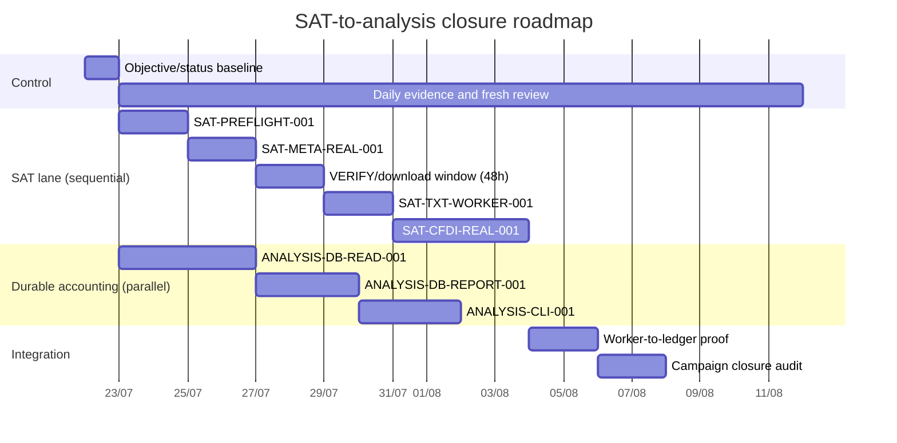

# SAT program objective and task orchestrator

This document is the short operating brief for completing the SAT-to-analysis
program. It answers three questions before any work starts: **what outcome is
measurable, who owns each unit, and what evidence is sufficient to move on**.
The detailed work-unit registry remains [`workstreams.md`](workstreams.md); the
append-only record remains [`daily-evidence.md`](daily-evidence.md).

## 1. Single program objective

> **By closing the 2026 campaign, prove an auditable, restart-safe path from
> SAT v1.5 Metadata through ZIP/TXT, worker inventory, CFDI ZIP/XML, durable V5
> ledgers, and aggregate financial analysis in PostgreSQL, while preserving
> idempotency, tenant/evidence provenance, external artifact storage, and zero
> fiscal-data leakage from Git, logs, jobs, or public output.**

The objective is measurable only through the following exit scoreboard:

| Measure | Required result |
|---|---|
| Metadata | Each requested window has one request/claim and a categorized terminal result, or one persisted pending result within the 48-hour service window. |
| Real package proof | At least one real Metadata ZIP/TXT is validated and processed once when SAT returns data; `no_data` or `service_window_exceeded` is a valid bounded outcome when it does not. |
| CFDI proof | Only eligible metadata can create a new `cfdi-proof` grant; at least one real CFDI ZIP/XML is validated and processed once when eligible data exists. |
| Durable accounting | Worker writes for concepts, taxes, payments, payroll, and related rows are tenant-safe, evidence-bound, and idempotent in PostgreSQL. |
| Analysis | Monthly, tax, payment, payroll, and quality reports expose aggregates plus completeness/provenance state; they never infer legal or tax conclusions. |
| Safety | No duplicate request, claim, download, or job; no RFC, UUID, SAT ID, SOAP, secret, row, raw artifact, or local absolute path appears in public evidence. |

Synthetic tests prove implementation contracts. They do **not** promote a SAT
row to accepted evidence. A no-data result closes that bounded observation; it
does not prove that another period contains no data.

## 2. Scope, boundaries, and human gate

### In scope

- SAT v1.5 `received` and `issued` Metadata for the frozen campaign window
  `2026-01-01..2026-07-15`, starting with `2026-01-01..2026-01-14`.
- Due-aware VERIFY and download with a five-minute wake-up, persisted
  `next_check_at`, maximum two open SAT operations, and a 48-hour local service
  window for new requests.
- External ZIP/TXT/XML storage, safe extraction, opaque RabbitMQ references,
  worker inventory, V5 child ledgers, and aggregate PostgreSQL analysis.
- Sanitized daily evidence and fresh review for every work unit.

### Out of scope for this objective

- PDF generation, portal scraping, individual folio recovery, tax/legal advice,
  automatic cancellation decisions, and replacement requests for pending or
  uncertain operations.
- FastAPI, PyPI/release work, system scheduler activation, and legacy-shim
  cleanup until the first ZIP/TXT and XML proof is recorded.
- Real credentials, artifacts, or fiscal rows in the repository, fixtures,
  logs, issues, chat, or message bodies.

### Human SAT gate

No task may contact SAT unless Carlos explicitly authorizes the exact campaign,
phase, direction, date window, profile, grant, and storage boundary. The
executor must stop on missing credentials, endpoint overrides, CI mode, identity
conflict, signature/configuration error, uncertain download, or unsafe payload.
The orchestrator records the decision; it never supplies or stores secrets.

## 3. Delegation contract

Every task is a bounded work unit with **one owner and one reviewer**. A second
writer cannot start on the same files or migration surface. The owner may
choose implementation details inside the boundary, but may not widen scope or
silently weaken a stop condition.

### Definition of ready

A task is `ready` only when its packet contains: stable ID, objective, owner
role, reviewer role, dependency IDs, clean start commit, exact in-scope files
or interfaces, explicit exclusions, tests/gates, acceptance threshold,
evidence ID, stop conditions, and next task. Missing information leaves it
`planned` or `blocked`.

### Required task packet

```text
TASK_ID:
OBJECTIVE:
WHY_NOW:
OWNER_ROLE:
REVIEWER_ROLE:
DEPENDS_ON:
START_BASE:
IN_SCOPE:
OUT_OF_SCOPE:
DELIVERABLES:
TESTS_AND_GATES:
ACCEPTANCE_CRITERIA:
EVIDENCE_ID:
STOP_CONDITIONS:
NEXT_TASK:
```

### Required handoff

```text
work_unit=<TASK_ID>
owner_role=<role>
branch=<sanitized-branch>
start_commit=<short-sha>
end_commit=<short-sha-or-none>
files=<repository-relative-paths>
tests=<command-and-result>
scanners=<ruff/sensitive/sat-context/diff/compose-as-applicable>
result=<confirmed|refuted|inconclusive|blocked>
status=<planned|in_progress|blocked|verified|accepted|inconclusive>
blocker=<fixed-category-or-none>
next_step=<one-action>
```

The handoff and evidence record contain aggregates and code lineage only. Never
include raw SOAP, fiscal rows, identifiers, credentials, artifact names,
absolute paths, or data hashes.

### Acceptance gates

1. **Scope:** only the packet's files, interfaces, dates, and budget changed.
2. **Correctness:** focused tests cover the stated behavior and failure paths.
3. **Safety:** sensitive/SAT-context scanners, Ruff, and `git diff --check` pass;
   storage remains outside the checkout and PostgreSQL holds references only.
4. **Runtime:** Compose/Flyway/worker gates pass when the packet changes them.
5. **Evidence:** reviewer confirms the daily entry proves the acceptance
   criteria; synthetic evidence remains `verified`, not live `accepted`.

### Stop conditions

Stop and mark `blocked` or `inconclusive` when a dependency is missing, a
credential/human decision is required, a claim or identity conflicts, a
download is uncertain, a ZIP/TXT/XML violates limits, a test/scanner fails for
an unexplained reason, or the result cannot distinguish absence of data from
absence of observation. Do not retry blindly; record one next action.

## 4. Dependency-aware roadmap and parallel lanes

Dates below are planning targets, not SAT response promises. The SAT lane is
event-driven and may remain pending for up to 48 hours per request.



The accounting lane may use synthetic fixtures while SAT waits. It cannot be
accepted as the complete program until the durable worker path and the real
SAT evidence (or a categorized bounded no-data outcome) are recorded.

### Ready task sequence

| Task ID | Owner | Reviewer | Depends on | Exit evidence |
|---|---|---|---|---|
| `SAT-PREFLIGHT-001` | SAT integration | QA/documentation | `SAT-PLAN-001` | Clean tree, canonical endpoints, external storage, exact human grant; no SAT call during preflight. |
| `SAT-META-REAL-001` | SAT integration | QA/documentation | `SAT-PREFLIGHT-001` | One claim/request per direction for the first window and categorized result. |
| `SAT-META-WAIT-001` | SAT integration | Worker/queue | `SAT-META-REAL-001` | Due-aware attempts, immutable history, and no replacement request. |
| `SAT-TXT-WORKER-001` | Storage/security | Worker/queue | `SAT-META-WAIT-001` | ZIP/TXT validation and one opaque metadata job consumed. |
| `SAT-CFDI-REAL-001` | SAT integration | Storage/security | `SAT-TXT-WORKER-001` | New grant, one eligible CFDI request, ZIP/XML validation, one XML job. |
| `ANALYSIS-DB-READ-001` | Analysis/accounting | Persistence/data | `LEDGER-V5-BIND-001` | V5-safe PostgreSQL reads and redacted completeness states. |
| `ANALYSIS-DB-REPORT-001` | Analysis/accounting | QA/documentation | `ANALYSIS-DB-READ-001` | Monthly/accounting/quality aggregate report over durable rows. |
| `ANALYSIS-CLI-001` | Analysis/accounting | QA/documentation | `ANALYSIS-DB-REPORT-001` | Operator report exposes aggregates only and documents provenance. |

## 5. Daily audit and status transitions

Append one evidence block per completed task or meaningful workday using the
same `E-YYYY-MM-DD-NNN` ID sequence in `daily-evidence.md`:

```text
evidence_id=<E-YYYY-MM-DD-NNN>
work_unit=<TASK_ID>
scope=<synthetic|container|live-preflight|live-SAT>
owner=<role>
commit=<short-sha-or-working-tree>
action=<one sentence>
evidence=<tests/scanners/runtime aggregate>
result=<confirmed|refuted|inconclusive|blocked>
status=<planned|in_progress|blocked|verified|accepted|inconclusive>
blocker=<fixed-category-or-none>
next_step=<one action>
```

Use these transitions only:

```text
planned → in_progress → verified → accepted
                    ↘ blocked
                    ↘ inconclusive
```

- `verified` means the owner and fresh reviewer passed the local gates.
- `accepted` requires Carlos/maintainer acceptance of the recorded evidence.
- `blocked` requires an external decision, credential, environment, or safety
  gate; it is not a synonym for “not started”.
- `inconclusive` preserves the request and states what observation is missing.

Before dispatching the next task, the orchestrator checks the predecessor's
status, evidence ID, commit, and acceptance criteria against `workstreams.md`.
If they disagree, the task stays `planned` and the discrepancy is recorded;
the orchestrator never upgrades a claim by interpretation.

## 6. Completion review

The final review is a checklist, not a narrative:

- [ ] First Metadata result is a real ZIP/TXT or categorized bounded no-data.
- [ ] Worker inventory and, when eligible, CFDI/XML jobs were each consumed once.
- [ ] V5 child ledgers and analysis read PostgreSQL with tenant/provenance state.
- [ ] No duplicate request, claim, download, or job exists.
- [ ] Full suite, Ruff, sensitive/SAT scanners, Compose, and diff checks pass.
- [ ] `daily-evidence.md`, `workstreams.md`, this objective, and code status agree.
- [ ] Any remaining item has an owner, dependency, next action, and stop rule.

Only after this checklist is reviewed may the program be called complete. A
future campaign or an API/release effort receives a new objective and new
evidence IDs rather than reusing this closure record.
